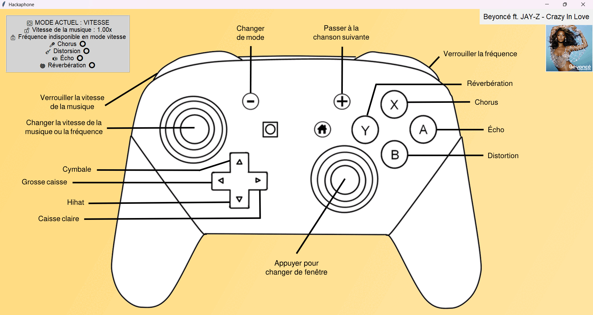

# Hackaphone
## 📎 Projet transdisciplinaire 2024/2025

## Auteurs

* 👤 [**MAZOUFFRE Jolan**](https://github.com/nalokage)
* 👤 [**NICKERSON Charlotte**](https://github.com/charlottenickersonensc)
* 👤 [**PAWELCZYK Baptiste**](https://github.com/baptiste5403)
* 👤 [**SAAB Alyaa**](https://github.com/alyaa203)

***

<details open="open">
  <summary><h2 style="display: inline-block">Table des matières</h2></summary>
  <ol>
    <li>
      <a href="#à-propos-du-projet">À propos du projet</a>
    </li>
    <li>
      <a href="#prérequis">Prérequis</a>
      <ul>
        <li><a href="#conditions-préalables">Conditions préalables</a></li>
        <li><a href="#installation">Installation</a></li>
      </ul>
    </li>
    <li>
      <a href="#utilisés-dans-ce-projet">Utilisés dans ce projet</a>
    </li>
  </ol>
</details>

<h2 id="à-propos-du-projet">À propos du projet</h2>



## Devenez DJ avec Hackaphone !

💿 Hackaphone est un projet permettant à n'importe qui de jouer les DJ !

Notre but est de créer un tout nouvel instrument de musique 🎵 qui permet de contrôler de la musique à distance ! Il s'agit d'un méta-instrument, c'est-à-dire un outil d’interaction musicale permettant de contrôler un rendu musical informatique.

On peut utiliser le méta-instrument de deux façons différentes :

● soit avec un téléphone 📱 et dans ce cas il faut lancer le fichier **Méta-instrument iPhone.bat** ;

● soit avec une manette Bluetooth de jeu vidéo 🎮 et dans ce cas il faut lancer le fichier **Méta-instrument Manette Bluetooth.bat**.

<h2 id="prérequis">Prérequis</h2>

Retrouvez les prérequis à effectuer afin de pouvoir lancer le projet.

<h3 id="conditions-préalables">Conditions préalables</h3>

La programmation a été faite en Python dans sa version **3.11.9**. Il est nécessaire d'avoir cette version (ou une version antérieure) car le projet dépend de la bibliothèque [pyo](https://pypi.org/project/pyo/) qui ne fonctionne que jusqu'à cette version de Python.

* [Installer Python 3.11.9 sur Python.org](https://www.python.org/downloads/release/python-3119/) | Lancez le téléchargement de Python pour votre plateforme.
* [Installer Python 3.11.9 à partir du Microsoft Store](https://apps.microsoft.com/detail/9nrwmjp3717k)

Il est également nécessaire d'avoir un **iPhone** car il est indispensable pour le projet de télécharger l'application [Data OSC](https://apps.apple.com/fr/app/data-osc/id6447833736). Il est nécessaire pour cela d'avoir iOS 16.0 ou une version ultérieure.

<p align="center">
  <a href="https://apps.apple.com/fr/app/data-osc/id6447833736" target="_blank">
    
  </a>
</p>
<p align="center">
  Logo de 
  <a href="https://apps.apple.com/fr/app/data-osc/id6447833736" target="_blank">
    Data OSC
  </a>
</p>

<h3 id="installation">Installation</h3>

1. Cloner le dépôt sur votre machine personnelle, à l'aide de [Git](https://git-scm.com/downloads) ou en téléchargeant les fichiers manuellement (flèche verte puis "Download ZIP")
   ```
   git clone https://github.com/charlottenickersonensc/Hackaphone.git
   ```

2. Se diriger vers le répertoire du projet
   ```
   cd Hackaphone
   ```

3. Installer les dépendances du projet
   ```
   pip install -r requirements.txt
   ```

4. Ouvrir sur le téléphone l'application **Data OSC**, et se connecter au même réseau Wi-Fi **privé** sur l'ordinateur et sur le téléphone. Cochez **OSC** puis dans le champ **IP Address**, renseignez l'adresse IP du réseau Wi-Fi (adresse IPv4).

5. Lancer le projet : il faut double-cliquer sur le fichier **"Méta-instrument iPhone.bat"** ou en fonction de l'utilisation sur **"Méta-instrument Manette Bluetooth.bat"**. Dans ce dernier cas, il est impératif d'avoir connecté sa manette en Bluetooth au téléphone et d'avoir coché **Controller** dans Data OSC.

6. Il est possible d'ajouter des musiques. Nous avons utilisé [spotDL](https://github.com/spotDL/spotify-downloader) pour obtenir les chansons voulues et notamment pour récupérer leurs miniatures qui sont affichées dans l'interface graphique. Les chansons sont à ajouter au format **.mp3** dans le dossier **Chansons**.

<h2 id="utilisés-dans-ce-projet">Utilisés dans ce projet</h2>

| Langage         | Applications                                          |
| :-------------: | :--------------:                                      |
| Python          | Pure Data (n'est plus utilisé dans la version finale) |
|                 | Visual Studio Code                                    |
|                 | Git / GitHub                                          |